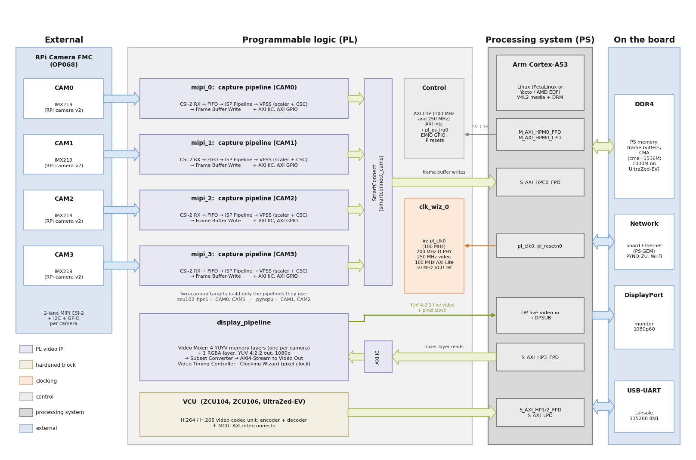
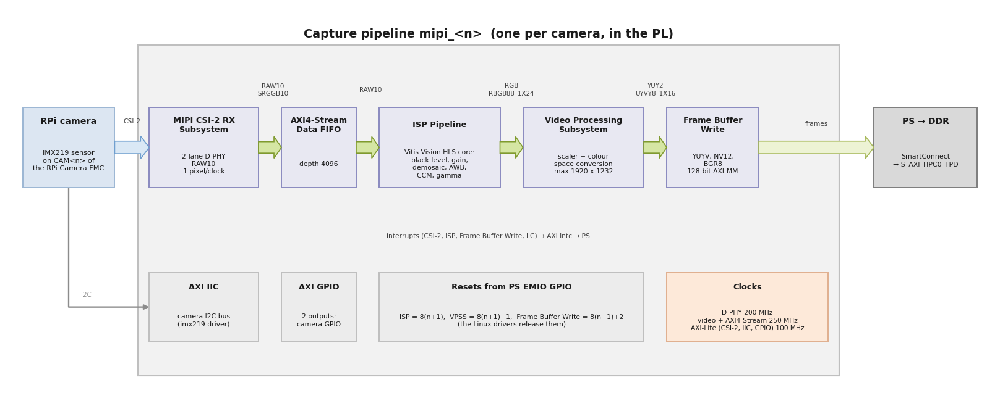
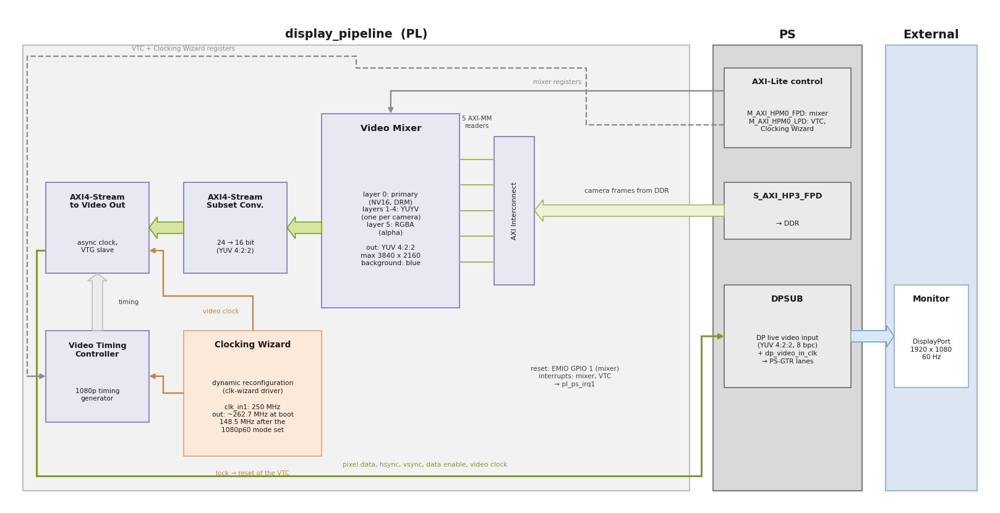
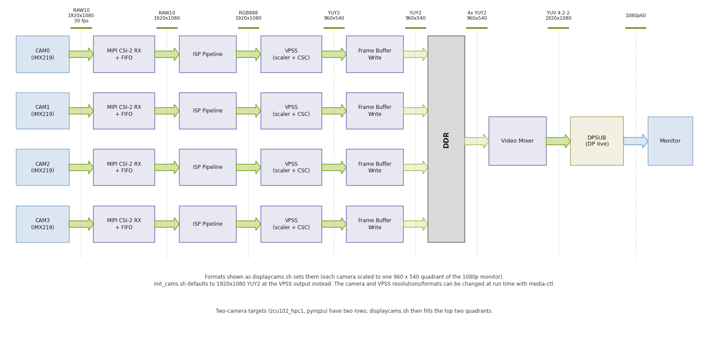
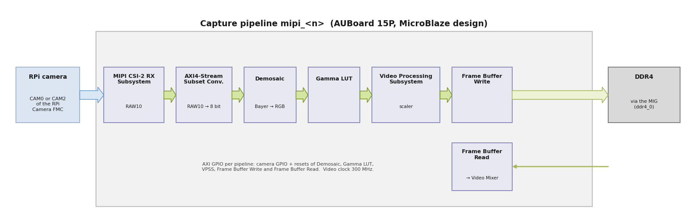
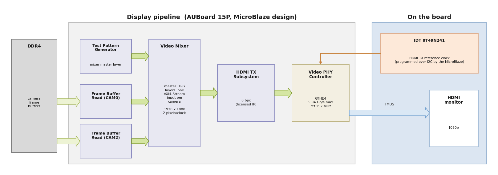

# Description

This repository contains two flavours of reference design for the [RPi Camera FMC]:

* **Zynq UltraScale+ designs** — one MIPI capture pipeline per camera, each with the
  ISP Pipeline IP, plus a Video Mixer based display pipeline that drives the
  DisplayPort output of the Zynq UltraScale+ PS. They run embedded Linux, built with
  either PetaLinux or Yocto (AMD EDF), and are controlled from userspace with the
  standard V4L2 / media-ctl / DRM tools and [GStreamer].
* **FPGA designs** (Artix UltraScale+, AUBoard 15P) — a simpler MIPI capture pipeline
  per camera and an HDMI output, driven by a baremetal application running on a
  MicroBlaze.

## Hardware Platforms

The hardware designs provided in this reference are based on Vivado and support a range of FPGA / MPSoC evaluation
boards. The repository contains all necessary scripts and code to build these designs for the supported platforms listed below:


    
    
        
            
        
    
    
### {{ group.name }} platforms

| Target board        | FMC Slot Used | Cameras | VCU |
|---------------------|---------------|---------|-----|
| [{{ design.board }}]({{ design.link }}) | {{ design.connector }} | {{ design.cams | length }}x |  ✅  ❌  |




## Software

| Environment | Targets | Available applications |
|-------------|---------|------------------------|
| PetaLinux   | Zynq UltraScale+ designs | Built-in Linux commands, `init_cams.sh`, `displaycams.sh`<br>Additional tools: `v4l2-ctl` / `media-ctl` (v4l-utils), `modetest`, `yavta`, [GStreamer] |
| Yocto (AMD EDF) | Zynq UltraScale+ designs | Built-in Linux commands, `init_cams.sh`, `displaycams.sh`<br>Additional tools: `v4l2-ctl` / `media-ctl` (v4l-utils), `modetest`, [GStreamer] (`v4l2src`, `kmssink`, compositor, videoconvertscale, videotestsrc), SSH server |
| Baremetal   | FPGA designs (AUBoard 15P) | Camera to HDMI example application |

The PetaLinux and Yocto images are built from the same hardware design and contain the
same camera and display drivers, kernel patches and example scripts, so the
[usage and test guide](testing) applies to both.

## Architecture (Zynq UltraScale+ designs)

The hardware design for these projects is built in Vivado and is composed of IP that implement the
MIPI interface with the cameras, the display pipeline and (on some boards) the VCU.
The main elements are:

* Up to four Raspberry Pi cameras, each with an independent MIPI capture pipeline that writes
  frames to the PS DDR memory
* A Video Mixer based display pipeline that reads the frames back from DDR, composes them and
  sends the result to the DisplayPort live video input of the Zynq UltraScale+ PS
* The Video Codec Unit ([VCU]) on the targets whose device has one (ZCU104, ZCU106, UltraZed-EV)

The block diagram below illustrates the design from the top level.



The diagrams on this page are generated from the block-design scripts
(`Vivado/src/bd/bd_zynqmp.tcl` and `Vivado/src/bd/bd_mb.tcl`) by the script
`docs/source/images/gen_block_diagram.py`.

### Capture pipeline

There is one capture pipeline per camera port that the target supports (four on most targets,
two on `zcu102_hpc1` and `pynqzu`). Each capture pipeline is composed of the following IP,
implemented in the PL of the Zynq UltraScale+:

* [MIPI CSI-2 Receiver Subsystem IP](https://docs.xilinx.com/r/en-US/pg232-mipi-csi2-rx)
* [AXI4-Stream Data FIFO](https://docs.amd.com/r/en-US/pg085-axi4stream-infrastructure/AXI4-Stream-Data-FIFO)
* [ISP Pipeline of the Vitis Libraries](https://github.com/Xilinx/Vitis_Libraries/tree/main/vision/L3/examples/isppipeline)
* [Video Processing Subsystem IP](https://docs.xilinx.com/r/en-US/pg231-v-proc-ss)
* [Frame Buffer Write IP](https://docs.xilinx.com/r/en-US/pg278-v-frmbuf)
* AXI IIC (the camera's I2C bus) and AXI GPIO (the camera's enable/GPIO lines)

The MIPI CSI-2 RX IP is the front of the pipeline and receives image frames from the Raspberry Pi camera
over the 2-lane MIPI interface. It outputs an AXI4-Stream of the frames in RAW10 (Bayer) format.
The ISP Pipeline IP is an HLS core built from the Vitis Vision library (the `ip` build stage
generates it); it performs black-level correction, gain control, demosaicing, auto white balance,
colour correction and gamma correction, and outputs the frames in RGB888 format. The Video Processing
Subsystem IP performs scaling and colour space conversion, and the Frame Buffer Write IP writes the
frame data to memory (DDR) through the `S_AXI_HPC0_FPD` port of the PS. The resets of the ISP, VPSS
and Frame Buffer Write IP are driven by PS EMIO GPIOs. The image below illustrates one capture
pipeline.



The white balance gains, the AWB threshold and the gamma curves of the ISP are exposed as V4L2
controls; see [ISP controls](testing.md#isp-controls).

### Display pipeline

The display pipeline reads frames from memory (DDR) and sends them to the monitor. To allow for four video streams to be
displayed on a single monitor, the design uses the Video Mixer IP with four overlay layers configured as memory mapped
AXI4 interfaces (one per camera, YUYV format), plus a primary layer (NV16) and an RGBA layer with alpha.
The Video Mixer reads the layers from DDR through the `S_AXI_HP3_FPD` port and outputs an AXI4-Stream
of YUV 4:2:2 video. An AXI4-Stream Subset Converter and the AXI4-Stream to Video Out IP turn the stream
into the parallel video (pixel data, sync and data enable) of the DisplayPort live video input of the PS,
with timing from the Video Timing Controller (VTC).



The video clock comes from a Clocking Wizard with dynamic reconfiguration, fed by the 250 MHz
clock of the design. Linux (the `clk-wizard` driver) programs it to the pixel clock of the
display mode when the mode is set; at boot it runs at about 262.7 MHz (the value set in the
block design), and after a 1920x1080 at 60 Hz mode set it runs at 148.5 MHz. The Video Timing
Controller is held in reset until the Clocking Wizard is locked.

```{important}
The display pipeline supports **1920x1080 at 60 Hz only**. Always pin the mode with the `-60`
suffix when you set it with `modetest` (the `displaycams.sh` script does this for you). See
[Display](testing.md#display).
```

### End-to-end pipeline

The end-to-end pipeline shows an example of the flow of image frames through the entire system, from source to sink.
In the diagram, the image resolutions and pixel formats are shown at each interface between the image processing
blocks, as configured by the `displaycams.sh` script. The resolution and pixel format can be dynamically changed at
the output of the RPi camera and of the scaler (Video Processing Subsystem IP).



### Clocks

| Clock | Source | Used by |
|-------|--------|---------|
| 100 MHz | PS `pl_clk0` | input of `clk_wiz_0` |
| 200 MHz | `clk_wiz_0` | MIPI D-PHY |
| 250 MHz | `clk_wiz_0` | capture pipelines (video and AXI4-Stream), Video Mixer, AXI-Lite on `M_AXI_HPM0_FPD`, PS slave ports, VCU AXI, input of the display Clocking Wizard |
| 100 MHz | `clk_wiz_0` | AXI-Lite on `M_AXI_HPM0_LPD` (CSI-2 RX, AXI IIC, AXI GPIO, VTC, Clocking Wizard, VCU, interrupt controller) |
| 50 MHz | `clk_wiz_0` | VCU PLL reference (on targets with a VCU) |
| 148.5 MHz (1080p60) | display Clocking Wizard | VTC and the DisplayPort live video clock |

### Video Codec Unit

For some of the target boards, the Zynq UltraScale+ device contains a hardened Video Codec Unit (VCU) that can be used to
perform video encoding and decoding of multiple video standards. On those target designs, we have included the VCU to 
enable these powerful features. Refer to the list of target designs to see which boards support this feature.

## Architecture (FPGA designs)

The AUBoard 15P design uses a MicroBlaze processor and a simpler pipeline built from the
standard Video Processing IP. Each capture pipeline converts the RAW10 stream from the MIPI
CSI-2 RX to 8 bits, then demosaics it, applies a gamma LUT, scales it and writes it to the
DDR4 memory. A Frame Buffer Read per camera reads the frames back for the display pipeline.



The display pipeline uses the Video Mixer to combine the camera streams (with a Test Pattern
Generator on the master layer) and sends the result to an HDMI monitor through the HDMI TX
Subsystem and the Video PHY Controller. The HDMI TX Subsystem requires an
[IP license](https://www.amd.com/en/products/adaptive-socs-and-fpgas/intellectual-property/hdmi.html)
(an evaluation license is available).




[RPi Camera FMC]: https://docs.opsero.com/op068/datasheet/overview/
[GStreamer]: https://gstreamer.freedesktop.org/
[VCU]: https://xilinx-wiki.atlassian.net/wiki/spaces/A/pages/18842546/Xilinx+Zynq+UltraScale+MPSoC+Video+Codec+Unit
