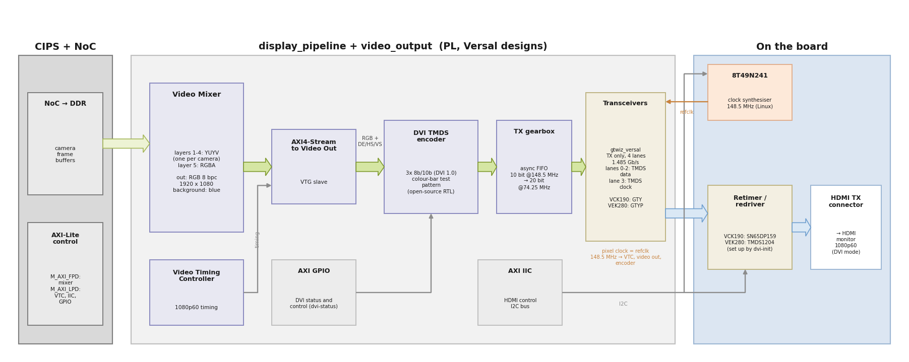

# Versal designs

This page covers the designs for the AMD Versal evaluation boards: the [VCK190] (Versal AI Core)
and the [VEK280] (Versal AI Edge). They use the same capture pipeline and the same Linux camera
software as the Zynq UltraScale+ designs. The differences are:

* **Video output.** Versal devices have no DisplayPort controller in the processing system and no
  GPU. The Versal designs send the Video Mixer output to the board's **HDMI TX connector** as a
  DVI signal (1920x1080 at 60 Hz, RGB, no audio). The DVI output is built from free IP and our
  own open-source (MIT licensed) TMDS encoder, so it needs **no HDMI IP license**.
* **Camera ports.** Each target supports 2 or 3 of the four camera ports of the
  [RPi Camera FMC] (see [Camera ports](#camera-ports)).
* **Linux flow.** The Versal designs are built with the [Yocto](yocto) (AMD EDF) flow only.
  There is no PetaLinux project for them.
* **Baremetal application.** A standalone application for the Cortex-A72 shows the cameras on
  the HDMI monitor without Linux (see [Baremetal application](#baremetal-application)).

## Target designs

| Target design | Board | FMC connector | Camera ports |
|---------------|-------|---------------|--------------|
| `{{ design.label }}` | [{{ design.board }}]({{ design.link }}) | {{ design.connector }} | `CAM{{ c }}`{{ ", " if not loop.last }} |


Both boards need a Vivado ML **Enterprise** Edition license (the Versal devices on these boards
are not supported by the Standard Edition); a 30-day evaluation license is available from AMD.
No separately licensed IP is used.

```{note}
The `vck190_fmcp1` design has been tested on hardware by Opsero: video capture from cameras on
`CAM0` and `CAM2`, the DVI output, and `displaycams.sh`. The `vck190_fmcp2` and `vek280`
designs build without errors and use the same hardware design and software, but they have not
yet been tested on hardware by Opsero. If you run them, we would like to hear about your results
([contact Opsero]).
```

## Architecture



The block design is `Vivado/src/bd/bd_versal.tcl`, and the DVI output hierarchy is
`Vivado/src/bd/dvi_out.tcl`. The main elements are:

* **Control, Interfaces and Processing System (CIPS)** with the board's preset: the PS UART, SD card,
  Ethernet (GEM0) and I2C, plus the PL clock and the interrupts. The resets of the ISP, VPSS,
  Frame Buffer Write and Video Mixer IP are driven by PMC EMIO GPIOs, with the same bit map as
  the Zynq UltraScale+ designs.
* **NoC and DDR memory**: one memory controller (DDR4 on the VCK190, LPDDR4 on the VEK280). The
  frame buffer writers of the cameras share one NoC port, and the Video Mixer reads through another.
* **Capture pipelines**, one per supported camera port, the same as on Zynq UltraScale+
  (see [Capture pipeline](description.md#capture-pipeline)): MIPI CSI-2 RX Subsystem (2 lanes,
  RAW10, 420 Mb/s per lane), AXI4-Stream Data FIFO, ISP Pipeline (HLS), Video Processing
  Subsystem and Frame Buffer Write, plus an AXI IIC and an AXI GPIO for each camera. On Versal the
  MIPI D-PHY is implemented in the XPIO banks (XPHY); the pins come from the target's XDC file.
* **Display pipeline**: a Video Mixer with four YUYV memory layers (one per camera) and an RGBA
  layer, configured for an **RGB** output (the ZynqMP designs output YUV 4:2:2 to the DisplayPort),
  and a Video Timing Controller set to 1080p60.
* **DVI output** (hierarchy `video_output`):
  - AXI4-Stream to Video Out, timed by the VTC, converts the mixer stream to parallel video.
  - A TMDS encoder (DVI 1.0, `Vivado/src/hdl/dvi/`) encodes the three colour channels with the
    sync signals. It also contains a colour-bar test pattern generator with its own 1080p60
    timing, used to check the output path without the mixer.
  - A gearbox (asynchronous FIFO) converts the 10-bit symbols at the 148.5 MHz pixel clock to
    20-bit words at 74.25 MHz for the transceivers.
  - The transceivers (Transceivers Wizard, `gtwiz_versal`, TX only) send the three TMDS data
    lanes and the TMDS clock at 1.485 Gb/s per lane. VCK190: GTY quad 106; VEK280: GTYP bank 204.
  - An AXI IIC on the board's HDMI control I2C bus, and an AXI GPIO with the status and control
    register of the DVI output.

The transceiver reference clock comes from the board's Renesas 8T49N241 clock synthesiser, which
Linux programs to 148.5 MHz at boot. The pixel clock is derived from the same reference clock, so
the pixel clock and the transceiver clock are locked in frequency. On the board, the transceiver
lanes go through a TI SN65DP159 retimer (VCK190) or a TI TMDS1204 redriver (VEK280) to the HDMI
TX connector. The `dvi-init` service of the Linux image configures them at boot.

### Clocks

| Clock | Source | Used by |
|-------|--------|---------|
| 100 MHz | CIPS `pl0_ref_clk` | input of the main Clocking Wizard |
| 250 MHz | Clocking Wizard | capture pipelines, Video Mixer, NoC ports |
| 100 MHz | Clocking Wizard | AXI-Lite control |
| 200 MHz | one Clocking Wizard per XPIO bank with cameras | MIPI D-PHY |
| 148.5 MHz | 8T49N241 on the board | transceiver reference clock and pixel clock (VTC, Video Out, TMDS encoder) |
| 74.25 MHz | transceiver TX output clock | transceiver user clock (gearbox read side) |

## Camera ports

On Versal devices the MIPI D-PHY receiver is built from the nibbles (groups of 6 pins) of an
XPIO bank. The clock lane of a camera must be on pin 0 of a nibble (a clock-capable pin), and its
capture clock is passed from that nibble to the nibbles of the data lanes over a fixed set of
inter-nibble and inter-byte clock routes in the bank. A nibble can carry the capture clock of only
one camera, including nibbles that only pass the clock on. On the [RPi Camera FMC] the pins of
each camera connect to fixed LA pairs of the FMC connector, so the board's pinout decides which
cameras can be received together:

* **VCK190 FMCP1** (`vck190_fmcp1`): `CAM0` and `CAM2`. `CAM1` uses some of the same nibbles of
  bank 706 as `CAM0`. `CAM3` has no clock pin from which its clock can reach both of its data
  lanes.
* **VCK190 FMCP2** (`vck190_fmcp2`): `CAM1`, `CAM2` and `CAM3`. `CAM0` needs nibbles of bank 708
  that `CAM1` and `CAM2` also use.
* **VEK280 FMCP** (`vek280`): `CAM0`, `CAM1` and `CAM3`. `CAM2` and `CAM3` need the same nibble
  of bank 706 to pass their clocks, so only one of them can be used.

All Versal designs select the clock of `CAM1` on LA01 and the clock of `CAM3` on LA31
(`CLK_SEL` = 0b10); the alternative clock pins (LA16, LA26) are not on pin 0 of a nibble.
Cameras connected to the other ports are not seen by the design.

## FMC VADJ voltage

* **VCK190:** U-Boot sets the FMC VADJ rail to **1.2V** (the IR38164 regulator, over I2C) before
  Linux boots, so the cameras' I2C buses and GPIOs work when the drivers probe. This is the I/O
  voltage that AMD specifies for MIPI D-PHY on Versal. If you boot Linux in another way, VADJ
  must be switched on before the camera drivers probe. The baremetal application has no
  U-Boot: it writes the same register values to the IR38164 itself before it accesses the FMC.
* **VEK280:** the FMC VADJ rail is fixed at **1.5V** by the board and cannot be changed (UG1612).
  The `vek280` design uses the `MIPI_DPHY` and `LVCMOS12` I/O standards in the FMC banks (705 and
  706), in the same way as AMD's VEK280 board file and the MIPI CSI-2 RX example design for the
  VEK280. This runs the MIPI banks outside AMD's specified VCCO of 1.2V for `MIPI_DPHY`
  (AM010). AMD's own VEK280 board file states this in its notes: "As per the schematic, bank 705 &
  bank 706 are provided with 1.5v (VADJ_FMC), but board file sets these bank pin's I/O standard to
  support MIPI interface (requires 1.2v)." The [RPi Camera FMC] itself tolerates a VADJ of up to
  1.8V.

## DVI output

* The output is DVI at a fixed **1920x1080, 60 Hz** (148.5 MHz pixel clock), RGB with 8 bits per
  colour. It has no audio and no HDMI InfoFrames. Any HDMI monitor accepts a DVI signal, and an
  HDMI to DVI cable also works.
* The monitor's EDID is not read; the 1080p60 mode is always used. The monitor must support it.
* Connect the monitor to the board's **HDMI TX** (output) connector:
  - **VCK190:** the HDMI connector is a stacked pair. The **top** port is HDMI TX; the bottom port
    is HDMI RX (input) and is not used.
  - **VEK280:** the HDMI TX connector (refer to the VEK280 user guide, UG1612, for its location).
* In Linux the Video Mixer is the DRM CRTC, as on the Zynq UltraScale+ designs. It drives a
  `panel-dpi` bridge with one fixed 1080p60 mode, so `modetest` shows a **`DPI-1`** connector
  (the ZynqMP designs show `DP-1`). The primary plane of the mixer takes an RGB format (`BG24`)
  instead of `NV16`; the four YUYV overlay planes are the same as on Zynq UltraScale+.

### DVI status and test pattern

The `dvi-status` command shows the state of the DVI output and can switch on the test pattern:

```
sudo dvi-status                # decode the status and control register
sudo dvi-status pattern on     # colour bars with their own 1080p60 timing (no mixer needed)
sudo dvi-status pattern off    # back to the Video Mixer output
```

In the status, `link ready`, `GT power good`, `GT TX reset done` and `FIFO streaming` must be 1,
and `FIFO underflow` / `FIFO overflow` 0. `HDMI HPD (sink)` is 1 when a monitor is connected.
With `pattern on`, the monitor shows eight vertical colour bars; this checks the clock
synthesiser, the transceivers, the retimer/redriver and the cable without the display pipeline.
Other sub-commands: `dvi-status reset` (restart the transceivers), `dvi-status clear` (clear the
sticky flags), `dvi-status wait [seconds]`.

## Build

The Versal designs are built on a native Linux machine with Vivado and Vitis 2025.2 and the Yocto
host packages (see [Yocto](yocto.md#requirements)). To build the Vivado design and the Yocto image,
and gather the SD card files into a zip:

```
./build.sh all --target vck190_fmcp1
```

Replace `vck190_fmcp1` with `vck190_fmcp2` or `vek280` for the other targets. To build only the
Yocto image (the Vivado design is built first if needed), use
`./build.sh yocto --target <target>`. The output files are in `Yocto/<target>/images/linux/`:

| File | Description |
| --- | --- |
| `BOOT.BIN` | Boot image (PLM, PDI with the PL configuration, Arm Trusted Firmware, U-Boot) |
| `Image` | Linux kernel |
| `system.dtb` | Linux device tree |
| `rootfs.wic.xz` | Full SD card image (about 8 GiB when written) |
| `rootfs.wic.bmap` | Block map for `bmaptool` |
| `rootfs.tar.gz` | Root filesystem tarball |

`./build.sh all` (or `./build.sh package --target <target>`) gathers `rootfs.wic.xz`,
`rootfs.wic.bmap`, `BOOT.BIN`, `BOOTAA64.EFI` and a `readme.txt` into
`bootimages/rpi-camera-fmc_<target>_yocto-2025-2.zip`.

## Prepare the SD card

You need a microSD card of **16 GB or more**: the Versal disk image is 8 GiB, which is larger than
an "8 GB" card. Prepare the card on a Linux PC as described in
[Yocto: Prepare the SD card](yocto.md#prepare-the-sd-card), with one extra step: on Versal the image
also has no boot loader in the `EFI/BOOT` folder of the first partition, so copy **both**
`BOOT.BIN` and `BOOTAA64.EFI` to the first (FAT) partition after flashing the image:

```
sudo partprobe /dev/sdX
sudo mkdir -p /mnt/sd_esp
sudo mount /dev/sdX1 /mnt/sd_esp
sudo cp BOOT.BIN /mnt/sd_esp/BOOT.BIN
sudo mkdir -p /mnt/sd_esp/EFI/BOOT
sudo cp BOOTAA64.EFI /mnt/sd_esp/EFI/BOOT/BOOTAA64.EFI
sync
sudo umount /mnt/sd_esp && sudo rmdir /mnt/sd_esp
```

`BOOTAA64.EFI` is in the zip under `bootimages/`. If you use the files in
`Yocto/<target>/images/linux/` instead, extract it from the root filesystem tarball:

```
tar -xzf Yocto/<target>/images/linux/rootfs.tar.gz -O \
    ./usr/lib/systemd/boot/efi/systemd-bootaa64.efi > BOOTAA64.EFI
```

Without `BOOT.BIN` the board does not boot at all; without `BOOTAA64.EFI` the boot stops at the
U-Boot prompt.

## Boot

1. Plug the SD card into the board. On the **VCK190**, use the microSD slot of the Versal device;
   the board's second microSD slot belongs to the System Controller.
2. Set the board to boot from the SD card: DIP switch **SW1** set to 1000 (1=ON, 2=OFF, 3=OFF,
   4=OFF) on both the VCK190 and the VEK280. Refer to the user guide of the board (UG1366 for the
   VCK190, UG1612 for the VEK280) for the switch and slot positions.
3. Connect the [RPi Camera FMC] to the FMC connector of the target (`vck190_fmcp1`: FMCP1,
   `vck190_fmcp2`: FMCP2, `vek280`: FMCP) and connect [Raspberry Pi camera module v2] modules to
   the camera ports of the target (see [Camera ports](#camera-ports)).
4. Connect an HDMI monitor that supports 1920x1080 at 60 Hz to the **HDMI TX** connector (the top
   port of the stacked HDMI connector on the VCK190).
5. Connect the board's Ethernet port to your network (optional; it gives SSH access).
6. Connect the USB-UART of the board to your PC and open a terminal at 115200 baud (8N1). The
   USB-UART exposes several serial ports; the Linux console (`ttyAMA0`) is on the port of the
   Versal UART0. Open them all if you are not sure which is which.
7. Power on the board.

The PLM loads the boot image from the SD card, U-Boot starts the systemd-boot loader, and Linux
boots to a login prompt. Log in as **`amd-edf`**; on the first login you are asked to set a
password. The hostname is `vck190-rpi-2025-2` or `vek280-rpi-2025-2`. The image requests an
address by DHCP on the board's Ethernet port (`end0`) and runs an SSH server. The VCK190 image
sets a fixed MAC address on the Ethernet port; if you connect more than one VCK190 to a network,
give each board a different MAC address.

The kernel command line is the `options` line of the systemd-boot entry (there is no `boot.scr`
on Versal). It ends with the arguments of this design:
`clk_ignore_unused cma=1536M xlnx_mixer.connect_drm_bridge=1`.

## Test the cameras and the display

The commands are the same as on Zynq UltraScale+; see
[Using and testing the design](testing). In short:

```
sudo init_cams.sh       # configure the capture pipelines, list CAMn: /dev/mediaX = /dev/videoY
sudo displaycams.sh     # show every connected camera on the monitor
```

* `init_cams.sh` configures the pipelines of the camera ports of the target that have a camera
  connected; only those ports get a `/dev/video` device.
* `displaycams.sh` sets the 1920x1080 60 Hz mode on the `DPI-1` connector and shows the cameras
  in the quadrants of the monitor: on `vck190_fmcp1` the cameras on `CAM0` and `CAM2` fill the top
  row and the bottom half shows the blue background of the Video Mixer; on the three-camera
  targets the bottom-right quadrant is blue. The script picks the RGB primary plane format
  itself.
* `modetest -s` with its own test pattern only shows the blue background of the Video Mixer on
  the Versal designs (the pattern is drawn in the primary plane, which is not shown). To check
  the display path, use `displaycams.sh`, a GStreamer `videotestsrc` on one of the YUYV overlay
  planes (see [Check the display path with a test pattern](testing.md#check-the-display-path-with-a-test-pattern),
  with `DPI-1` and the RGB primary format in the `modetest` command), or `dvi-status pattern on`.
* The display clock check of the Zynq UltraScale+ designs does not apply: the Versal pixel clock
  is the fixed 148.5 MHz from the 8T49N241.

## Baremetal application

The Versal targets also have a standalone (baremetal) application that runs on the Cortex-A72 and
needs no Linux. It is the Versal version of the AUBoard application: it finds the cameras that are
connected and shows all of them on the HDMI monitor (DVI, 1920x1080 at 60 Hz), each camera
scaled to 960x540 in its own quadrant:

| Quadrant | Top | Bottom |
|----------|-----|--------|
| Left     | `CAM0` | `CAM2` |
| Right    | `CAM1` | `CAM3` |

Only the camera ports of the target are used (`vck190_fmcp1`: `CAM0`, `CAM2`; `vck190_fmcp2`:
`CAM1`, `CAM2`, `CAM3`; `vek280`: `CAM0`, `CAM1`, `CAM3`). A quadrant without a camera shows the
blue background of the Video Mixer.

The application:

1. sets the FMC VADJ to 1.2V on the VCK190 (IR38164 regulator on the PS I2C, the same values as
   U-Boot in the Linux image); on the VEK280 VADJ is fixed and nothing is changed,
2. programs the 8T49N241 for the 148.5 MHz transceiver reference clock (the same register values
   as the Linux clock driver), configures the SN65DP159 retimer (VCK190) or TMDS1204 redriver
   (VEK280) as `dvi-init` does, restarts the transceivers and checks the DVI link,
3. starts the Video Mixer and the VTC (1080p60), then
4. for each camera port: detects the sensor over I2C, configures the ISP pipeline (the same gains
   and gamma curve as the Linux image), the scaler (1920x1080 RGB to 960x540 YUV 4:2:2) and the
   Frame Buffer Write (three buffers, the mixer always shows the last complete frame), and starts
   the sensor.

The source code is in `Vitis/versal/src/` (Versal application) and `Vitis/common/src/`
(camera sensor drivers, shared with the AUBoard application). The camera ports come from the
hardware design (XSA) and the board from the target's `boardname`, so the same code builds for
all three targets.

### Build

On a Linux or Windows machine with Vivado and Vitis 2025.2:

```
./build.sh standalone --target vck190_fmcp1
```

Replace `vck190_fmcp1` with `vck190_fmcp2` or `vek280` for the other targets. The Vivado design is
built first if needed. The boot image is `Vitis/boot/<target>/BOOT.BIN` (PLM, PDI with the PL
configuration, and the application). `./build.sh all --target <target>` also packages it into
`bootimages/rpi-camera-fmc_<target>_standalone-2025-2.zip`.

### Run

1. Copy `BOOT.BIN` to the first (FAT32) partition of a microSD card. Only this file is needed.
   If the card holds the Linux image, keep a copy of its `BOOT.BIN` to restore it later.
2. Set up the board as in [Boot](#boot) (SD boot mode, the [RPi Camera FMC] on the target's FMC
   connector, cameras, HDMI monitor on the HDMI TX connector, USB-UART at 115200 baud) and power it on.

You can also load the application over JTAG without changing the SD card: in Vitis, open the
workspace `Vitis/<target>_workspace` and run the application on the hardware, or program the PDI
(`Vitis/<target>_workspace/test_app/_ide/bootimage/resources/rpi_wrapper.pdi`) and download the
ELF (`test_app/build/test_app.elf`) to Cortex-A72 #0 with XSDB.

Expected UART output for `vck190_fmcp1` with cameras on `CAM0` and `CAM2`:

```
################################################
#    Raspberry Pi Camera to DVI/HDMI Example   #
#    For the Opsero RPi Camera FMC (OP068)     #
################################################
Board: VCK190, Vitis 2025.2, 2 camera port(s) in the design

VADJ: IR38164 VOUT 0x0133 = 1.199 V, enable 0x80
DVI: 8T49N241 programmed (Q2 148.5 MHz: N 0x0B, OUTEN 0x04)
DVI: SN65DP159 retimer found, configuring for TMDS 1.485 Gb/s
DVI: link up, 1080p60
DVI: status 0xD720674F: link 1, streaming 1, underflow 0, overflow 0, HPD 1, GT retries 103, FIFO watchdog 0
Display: 1080p60, mixer with 6 layers

Detecting cameras:
  - CAM0: Raspberry Pi Camera v2 (IMX219)
  - CAM2: Raspberry Pi Camera v2 (IMX219)

Starting cameras:
  - CAM0: SUCCESS (mixer layer 1, quadrant 0)
  - CAM2: SUCCESS (mixer layer 2, quadrant 2)

Running. Commands: 's' = status, 'p' = DVI test pattern on/off
Status after 5 s:
  CAM0: 47.8 fps, CSI-2 ISR 0x80020000 (no errors), packets 0x165D
  CAM2: 47.6 fps, CSI-2 ISR 0x80020000 (no errors), packets 0xE8C9
DVI: status 0xD720674F: link 1, streaming 1, underflow 0, overflow 0, HPD 1, GT retries 103, FIFO watchdog 0
```

The status is printed again every 60 seconds, or when you type `s` in the terminal. Type `p` to
switch the colour-bar test pattern of the DVI output on or off (the monitor takes a few
seconds to lock to the new timing after each switch). The cameras run at about 48
frames per second (the IMX219 mode of the application); the display runs at 60 Hz. The number of
transceiver reset retries depends on how long the reference clock took to settle and is not an
error.

The application supports the [Raspberry Pi camera module v2] (IMX219). It also detects the
Digilent Pcam 5C (OV5640), but the ISP of the Versal designs is built for the RGGB Bayer pattern
of the IMX219, so the colours of an OV5640 are wrong.

## Troubleshooting

* **The board does not boot.** Check SW1 (1000), that the card is in the Versal SD slot (VCK190),
  and that `BOOT.BIN` is on the first partition.
* **The boot stops at the U-Boot prompt.** `EFI/BOOT/BOOTAA64.EFI` is missing from the first
  partition. Copy it as described above.
* **No camera is detected on the VCK190.** Check that U-Boot printed no error during the VADJ
  setup, and that the cameras are on the ports of the target.
* **Baremetal application: no camera is detected.** On the VCK190, check that the UART shows
  the VADJ line with `enable 0x80`. Check that the cameras are on the ports of the target.
* **The monitor stays dark.** Run `sudo dvi-status`. `HDMI HPD (sink)` 0 means no monitor is
  seen: check that the cable is in the HDMI TX port (the top port on the VCK190). If the link is
  not ready or the FIFO is not streaming, run `sudo dvi-status reset` and then
  `sudo dvi-status clear`. Check the `dvi-init` service with
  `systemctl status dvi-init` and `journalctl -u dvi-init`. Then try `sudo dvi-status pattern on`:
  if the colour bars appear, the output path works and the problem is in the display pipeline
  (mode set, `displaycams.sh`).

[VCK190]: https://www.xilinx.com/vck190
[VEK280]: https://www.xilinx.com/vek280
[RPi Camera FMC]: https://docs.opsero.com/op068/datasheet/overview/
[Raspberry Pi camera module v2]: https://www.raspberrypi.com/products/camera-module-v2/
[contact Opsero]: https://opsero.com/contact-us
